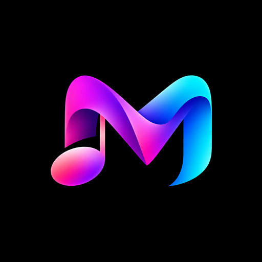

<div align="center">



# Melora

### Where Music Comes Alive.

A free, open-source YouTube Music client for Android — stream, download and manage your music in a clean, Spotify-style interface built on Material 3.

<br/>

[](https://github.com/RUPESHADHIKARI/Melora/actions/workflows/melora-apk.yml)
[](https://github.com/RUPESHADHIKARI/Melora/blob/main/LICENSE)
[](https://github.com/RUPESHADHIKARI/Melora/releases/latest)

<br/>

[**Download**](#download) · [**Features**](#features) · [**Build from source**](#build-from-source) · [**Credits**](#credits) · [**License**](#license)

</div>

---

> [!NOTE]
> **Regional Restriction** — If YouTube Music is unavailable in your region, Melora will not work without a **VPN or proxy** connecting to a supported region.

---

<div align="center">

<h1><a id="features"></a>Features</h1>

</div>

### Home, redesigned the Spotify way

- **Logo header with a time-based greeting** — *Good morning / afternoon / evening* — plus quick access to search, notifications, your account and Listen Together
- **Category filters** — instantly narrow every shelf to **All / Music / Playlists / Albums** with a horizontally scrollable pill row
- **Quick access (Speed dial)** — a Spotify-style **2-column grid** of your pinned & recently played music with per-item play buttons and paginated pages (music only, no clutter)
- **Real-data shelves** — *Recently played*, *Most played*, *Recommended albums*, *Popular artists*, *Playlists* and more, rendered as smooth horizontally scrolling cards. Sections only appear **when there is actually something to show**, so the home never feels empty or padded with placeholders

### Playback & library

- **Stream the whole YouTube Music catalog** — songs, videos, albums, artists, playlists
- **Background & lock-screen playback** with a polished notification
- **Download & offline playback** — cache songs or save full playlists to your device
- **Import / export backups** of your settings, playlists and history

### Theming & personalization

- **Signature Melora theme by default** — the blue-pink gradient blend of the app logo, in both light and dark mode. Themes are chosen in **Settings → Appearance** (including a chip that restores the signature blend), so the home screen always just looks right
- Material 3 with **dynamic color**, custom accent colors and **Black background** options
- **Synced lyrics** with per-song adjustments

### Extras

- Built-in **audio equalizer** with AutoEq-compatible presets and audio normalization
- **Sleep timer** with shake-to-dismiss
- **Listen Together** — share a synchronized listening session with friends
- Home-screen widget and **Android Auto** support

---

<div align="center">

<h1><a id="download"></a>Download</h1>

</div>

### Stable release (recommended)

Grab the latest optimized, signed build from the [**Releases**](https://github.com/RUPESHADHIKARI/Melora/releases/latest) page:

| | |
|---|---|
| **Current version** | [v1.0.1](https://github.com/RUPESHADHIKARI/Melora/releases/tag/v1.0.1) |
| **APK** | [`Melora-v1.0.1.apk`](https://github.com/RUPESHADHIKARI/Melora/releases/download/v1.0.1/Melora-v1.0.1.apk) (~24.6 MB) |
| **SHA-256** | `9A7F6332AD8C6F1125CF16C9EFFCCF9B8903A336C0B49553195C4BB64ACD6E98` |
| **Package** | `com.melora.app` (label: *Melora - by Rupesh*) |
| **Requires** | Android 8.0 (API 26) or newer |

> [!TIP]
> This is an **R8-minified, resource-shrunk, non-debuggable** build signed with a fixed certificate — install it once and future updates install cleanly over it.
> If you still have an old **Melora Debug** copy (`com.melora.app.debug`) installed, it lives alongside as a separate app; you can uninstall it after migrating your data via the in-app *Backup & restore* feature.

### Debug / test builds from CI

Every push to `main` automatically triggers the **Melora APK** workflow:

1. Open the [**Actions tab**](https://github.com/RUPESHADHIKARI/Melora/actions/workflows/melora-apk.yml)
2. Open the latest **Melora APK** run
3. Scroll down to **Artifacts** and download **`melora-foss-debug`**
4. Unzip and install `app-foss-debug.apk` on your device

> Artifact downloads require you to be signed in to GitHub. Debug builds are unoptimized and meant for testing only — prefer the stable release for daily use.

---

<div align="center">

<h1><a id="build-from-source"></a>Build from source</h1>

</div>

Requirements: **JDK 21** and the Android SDK (API 36+).

**Debug build** (for testing):

```bash
git clone https://github.com/RUPESHADHIKARI/Melora.git
cd Melora
./gradlew :app:assembleFossDebug
```

The debug APK will be located at `app/build/outputs/apk/foss/debug/app-foss-debug.apk`.

**Stable build** (R8-minified, signed — matching the published releases):

```bash
./gradlew :app:assembleFossRelease
```

The release APK will be located at `app/build/outputs/apk/foss/release/app-foss-release.apk` and is automatically signed by the build configuration.

---

<div align="center">

<h1><a id="credits"></a>Credits</h1>

</div>

Melora is a rebrand and redesign of [**Metrolist**](https://github.com/MetrolistGroup/Metrolist), itself a fork of other great open-source YouTube Music clients, and a free client that taps into the YouTube Music catalog. The project builds on that GPL-licensed foundation — thank you to the original developers and the community.

---

<div align="center">

<h1><a id="license"></a>License</h1>

</div>

Distributed under the **GNU General Public License v3.0**. See [`LICENSE`](LICENSE) for the full license text.

<div align="center">

<br/>

*MELORA — Designed and Developed by **Rupesh***

</div>
